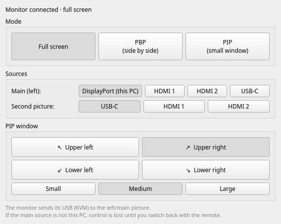

# FreEvnia

**Control no oficial y de código abierto para monitores Philips Evnia en Linux**: cambia de entrada, activa o
desactiva **PBP / PIP**, maneja el **Ambiglow** y cambia los ajustes del monitor (modo de imagen, entrada de
audio, opciones de juego, Power LED, CEC y el **cuidado del panel OLED**) desde tu PC, sin el Evnia Precision
Center (que solo existe para Windows).

> Sin relación con Philips ni TPV, ni respaldado por ellos. "Philips" y "Evnia" son marcas de sus
> propietarios y se usan solo para decir con qué monitores funciona.



## Por qué existe

El Philips Evnia 49M2C8900L solo acepta los cambios de entrada, PBP y PIP **por USB**, no por el canal DDC
de siempre: con `ddcutil` las lecturas funcionan, pero las escrituras a la fuente de entrada se aceptan sin
error y se ignoran. FreEvnia habla directamente con el hub USB del monitor.

Cómo funciona y cómo se descubrió: [PROTOCOL.md](PROTOCOL.md) (en inglés).

## Estado

Probado en un solo monitor: **Philips Evnia 49M2C8900L, firmware 1.08**. Todo lo de abajo está verificado en el
panel real (con una cámara cuando se puede ver).

| Funciona | Sin verificar / sin hacer |
|---|---|
| Entrada, pantalla completa / **PBP** / **PIP**, esquina y tamaño, segundo cuadro (USB-C, HDMI 1, HDMI 2) | PBP 2, PBP 3, intercambiar imágenes, HDMI como fuente *principal* |
| **Ambiglow**: todos los modos, color, posición, brillo y velocidad del OSD (los dibuja el monitor) | Seguir audio no se ha confirmado con cámara |
| Colores fijos del Ambiglow de cualquier valor RGB, dibujados por el PC | |
| Power LED, aviso de resolución, CEC, modo de imagen (SmartImage), entrada de audio | |
| Adaptive Sync, Smart Crosshair, Stark Shadow Boost, Smart Sniper | |
| Cuidado OLED: Pixel Orbiting, Screen Saver, Multi-Logo Protection, Boundary / Taskbar Dimmer, protección térmica | Refresco de píxeles (acción de mantenimiento, nunca se ejecutó durante el desarrollo) |

## Instalación

```bash
sudo apt install libusb-1.0-0
python3 -m venv .venv && . .venv/bin/activate
pip install -e ".[gui]"
sudo cp udev/99-freevnia.rules /etc/udev/rules.d/ && sudo udevadm control --reload
sudo udevadm trigger --subsystem-match=usb --attr-match=idVendor=2109   # hub (entrada, PBP/PIP, ajustes)
sudo udevadm trigger --subsystem-match=usb --attr-match=idVendor=0cf2   # controlador de luces (Ambiglow)
# no hace falta ningún grupo: la regla da acceso a quien tenga la sesión abierta en el equipo
```

El **cable USB de subida del monitor debe estar conectado a este equipo**.

## Uso

```bash
freevnia info
freevnia mode pbp1                       # PBP: este PC a la izquierda, USB-C a la derecha
freevnia mode pip --position lower-left --size large
freevnia mode off                        # pantalla completa

freevnia settings                        # todos los ajustes con su valor actual
freevnia settings smart-image fps        # cambia uno
freevnia settings audio-source displayport
freevnia pixel-refresh --yes             # ciclo de refresco de píxeles del OLED (el panel no se puede usar mientras dura)

freevnia ambiglow info                   # el ajuste de Ambiglow del propio monitor
freevnia ambiglow set --osd-mode "Color wave" --osd-color Rainbow --osd-brightness Brightest
freevnia ambiglow color "#ff8800" --zone sides   # un color fijo de cualquier valor RGB, lo dibuja el PC
freevnia ambiglow off                    # apaga las luces
freevnia ambiglow release                # devuelve las luces al monitor

freevnia-gui                             # la ventana (pestañas PBP/PIP, Ambiglow y Settings)
```

## Aviso importante

* **El monitor manda su USB (KVM) a la imagen principal, la de la izquierda.** Si pones *otro* aparato como
  fuente principal, este equipo pierde el hub y **no puede volver**: hará falta el mando.
* Siempre se sabe si hay PBP/PIP activo. El modo, la esquina y el tamaño solo se leen si los pusiste desde
  FreEvnia; lo que eliges con el **mando no se puede leer** (el monitor no lo informa).
* El monitor a veces responde a una lectura con su respuesta *anterior*; FreEvnia vuelve a preguntar hasta que
  la respuesta es coherente, por eso la pestaña Settings tarda unos segundos en cargar.
* **No escribas el código de Ambiglow `E2A038`**: es el reinicio de fábrica de los ajustes del Ambiglow.
* Escribe en la configuración del monitor. Usa los mismos comandos que el programa oficial, pero es software
  alfa: **úsalo bajo tu responsabilidad**, sin garantía (ver [LICENSE](LICENSE)).

## Próximos pasos

PBP 2 y 3, intercambio de imágenes, fuentes HDMI como principal, confirmar seguir audio con cámara, otros
modelos, y empaquetado (PyPI, AUR, Flatpak) y widget de Plasma.

## Licencia

MIT. [English README](README.md).
