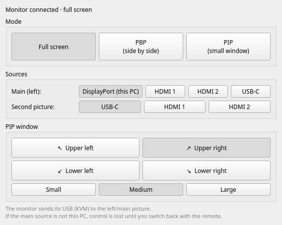

# FreEvnia

**Unofficial, open-source control for Philips Evnia monitors on Linux** - switch inputs and turn
**PBP / PIP** on and off from your PC, without the (Windows-only) Evnia Precision Center.

> Not affiliated with, endorsed by or supported by Philips or TPV. "Philips" and "Evnia" are trademarks
> of their owners and are used here only to say which monitors this works with.



## Why

The Philips Evnia 49M2C8900L accepts input / PBP / PIP changes **only over USB**, not over the usual
DDC channel (`ddcutil` reads work, but writes to the input source are silently ignored). The official
app is Windows-only. FreEvnia talks to the monitor's USB hub directly, so it works on Linux and, since it
is just USB control transfers, on anything that can run `libusb`.

How it works and how it was reverse-engineered: [PROTOCOL.md](PROTOCOL.md).

## Status

Tested on one monitor: **Philips Evnia 49M2C8900L, firmware 1.08**.

| Works (verified on the panel) | Not verified / not done |
|---|---|
| Read model, firmware, VCP values | PBP 2, PBP 3 |
| Full screen / **PBP** / **PIP** on and off | Swap pictures |
| PIP in the 4 corners, 3 sizes | HDMI as the *main* source |
| Second picture: USB-C, HDMI 1, HDMI 2 (PBP and PIP) | Other Evnia models (see below) |

The official app's own data flags other Evnia models as USB-DDC capable; they may work, but **I have not
tested any of them**. Reports and pull requests are welcome.

## Install

```bash
sudo apt install libusb-1.0-0        # or your distro's equivalent
python3 -m venv .venv && . .venv/bin/activate
pip install -e ".[gui]"               # drop [gui] if you only want the command line
```

Let your user talk to the device (no root needed afterwards):

```bash
sudo cp udev/99-freevnia.rules /etc/udev/rules.d/
sudo udevadm control --reload
sudo udevadm trigger --subsystem-match=usb --attr-match=idVendor=2109
# your user must be in the "plugdev" group
```

The monitor's **USB upstream cable must be connected to this computer**.

## Use

```bash
freevnia info                                   # model, BOM, firmware, scaler (read-only)
freevnia get 0x60                               # read a VCP code (read-only)
freevnia mode pbp1                              # side by side: this PC on the left, USB-C on the right
freevnia mode pip --position lower-left --size large
freevnia mode off                               # back to full screen
freevnia mode pbp1 --sub hdmi2                  # choose the second picture
freevnia-gui                                    # the window shown above
```

A launcher for KDE/GNOME menus is in `contrib/freevnia.desktop`; `contrib/pbp-toggle.sh` toggles PBP
(handy for a global keyboard shortcut).

## Read this before you use it

* **The monitor sends its USB (KVM) to the left / main picture.** If you make *another* device the main
  source, this computer loses the hub and **cannot switch back** - you will need the remote. The GUI asks
  for confirmation before changing the main source.
* The GUI always knows whether PBP/PIP is active (`0xE6`). Mode, corner and size read back only for what you set
  from FreEvnia; what you choose with the **remote cannot be read** (the monitor does not report it).
* This writes to your monitor's configuration. It uses the same commands as the official app, but it is
  alpha software: **use at your own risk**, no warranty (see [LICENSE](LICENSE)).

## Roadmap

* **Ambiglow (rear light) control** - the lights are driven by a separate USB device (`0cf2:b20b`, ENE)
  and need their own protocol work.
* Verify and enable PBP 2 / 3, picture swap, HDMI sources.
* Other Evnia models; a proper list of tested hardware.
* Packaging (PyPI, AUR, Flatpak) and a KDE Plasma widget.

## Related projects

* [tomasf/evnia](https://github.com/tomasf/evnia) - macOS (Swift) library for the 49M2C8900 Ambiglow LEDs over USB.

## License

MIT - see [LICENSE](LICENSE). [README en español](README.es.md).

## Ambiglow

`freevnia ambiglow color red|#ff8800 [--zone all|sides|top|center] [--brightness 50]`, `off`, `release`, `rainbow`, `breathe <colour>`, `status`; the GUI has a colour panel. The monitor's own presets can be read (`ambiglow info`) but not selected over USB: after `release` the LEDs stay dark until you pick a preset in the OSD. See PROTOCOL.md.

## Monitor settings and OLED panel care

`freevnia settings` lists them; `freevnia settings <key> <value>` changes one (Power LED, resolution notice,
CEC, Pixel Orbiting, Screen Saver, Multi-Logo Protection, Boundary/Taskbar Dimmer, Thermal Protection, Auto
Warning). The GUI has a *Settings* tab. `freevnia pixel-refresh --yes` starts the OLED pixel-refresh cycle (a
maintenance action; the panel is unusable while it runs). `freevnia ambiglow info` shows the monitor's own
Ambiglow setting. See PROTOCOL.md.

`freevnia ambiglow info` shows the monitor's Ambiglow setting; `freevnia ambiglow set --osd-mode "Follow video" --osd-brightness Brightest` changes it. Fixed colours are drawn by FreEvnia; `release` hands the LEDs back through the monitor itself.

The monitor itself only draws *follow video* (and *off*). For *static, color shift, color wave, color breathing and
starry night* FreEvnia draws the effect with the colour, position, brightness and speed stored in the monitor:
the GUI does it when you change the mode, and `freevnia ambiglow play` does it from the shell. Static stays after
the program exits; the animated ones need the program running (closing the window gives the LEDs back).
*Follow audio* is left to the monitor and was not tested.
